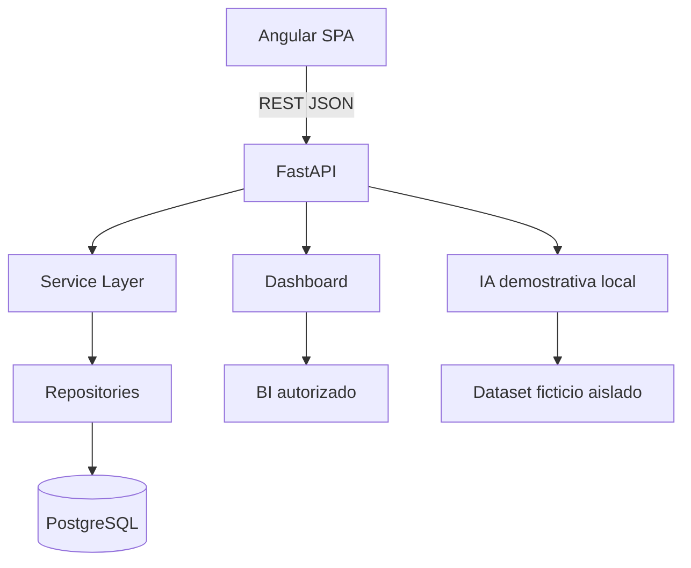

# Paideia

Plataforma inteligente para el seguimiento y prevencion del riesgo academico de estudiantes de la IE Paideia Newton, Trujillo, La Libertad, Peru.

## Problema

La institucion gestiona informacion academica en hojas Excel dispersas. La consolidacion, analisis y seguimiento requieren trabajo manual.

## Objetivo

Centralizar los datos académicos y apoyar el seguimiento institucional con módulos transaccionales y un dashboard.

## Alcance

Incluye autenticación, usuarios, estudiantes, cursos, calificaciones, asistencia,
seguimiento, dashboard, reportes e importación Excel/CSV. BI consulta evidencia
autorizada de PostgreSQL. La IA local funciona exclusivamente en demostración con
datos ficticios aislados; no genera alertas institucionales ni decisiones automáticas.

La evaluación configurable ofrece competencias, criterios, pesos, fórmulas de
previsualización, borradores, publicación y versiones. La evidencia ejecutada está
en [validación académica](docs/academic/validacion-segunda-laptop-fase4b.md).
Opcionales incompletos y precedencia de fórmulas/pesos siguen pendientes de política;
los indicadores de referencia no habilitan cálculos oficiales ambiguos.

La [auditoría 4A](docs/academic/auditoria-fase4a.md) conserva los antecedentes.
El [roadmap vigente](docs/development/roadmap.md) distingue cambios probados,
pendientes institucionales y límites de despliegue. No se declara producción lista.

## Arquitectura



## Stack tecnologico

| Capa | Tecnologia |
| --- | --- |
| Frontend | Angular 20.3, TypeScript 5.8.3, Vitest |
| Backend | Python 3.12-slim, FastAPI 0.141, Pydantic 2, SQLAlchemy 2 |
| Datos | PostgreSQL 17-alpine, Alembic |
| Analítica e IA | Indicadores PostgreSQL; pandas/numpy/sklearn local, modelos JSON demostrativos |
| Infraestructura | Docker, Docker Compose; frontend sobre Node.js 24-alpine |

## Modulos

Autenticación, usuarios, estudiantes, cursos y asignaciones, calificaciones,
asistencia, seguimiento, dashboard, reportes, importación, BI e IA experimental.
Se conserva el portal familiar existente; el alcance no se amplía a un ERP.

## BI e IA experimental

Analítica: filtros, cobertura, distribuciones, tendencias, comparación de periodos
y asistencia. Distingue cero, ausencia e incompletitud; usa pesos históricos.
Los conteos demostrativos de IA se muestran separados de los indicadores académicos.

IA: un administrador solicita entrenamiento ficticio, revisa métricas/baseline,
aprueba y activa explícitamente una versión; puede restaurar una anterior.
El entrenamiento ocurre en un proceso auxiliar bajo demanda y no reemplaza el
modelo activo. Datos y artefactos quedan en PostgreSQL; no se suben datasets ni
modelos privados. La IA institucional permanece inactiva hasta disponer de política,
historia autorizada suficiente, validación y aprobación. Sin APIs externas ni costos.
Véanse [operación IA](docs/ai/operacion-modelos-locales.md) y
[evidencia BI/IA](docs/bi/validacion-bi-ia.md).

## Estructura del repositorio

```text
backend/   FastAPI, SQLAlchemy, Alembic y tests
frontend/  Angular SPA y componentes base
database/  migraciones/configuracion, respaldos y padrón escolar local excluido de Git
ml/        estructura de IA sin modelos entrenados
bi/        SQL, datasets y KPIs de analitica de negocio
docs/      requisitos, arquitectura, Scrum, IA y analitica de negocio
```

## Requisitos previos

Git y Docker/Compose. Python 3.12 permite generar la configuración privada sin instalar dependencias de la aplicación; también puede ejecutarse mediante Docker según la guía. Node.js solo es necesario para desarrollo Angular nativo.

## Inicio rapido con Docker

Clona el repositorio y entra en su directorio:

```bash
git clone https://github.com/wesarzein/Paideia.git
cd Paideia
```

Genera un entorno propio con secretos nuevos, sin cambiar el `.env` de otra instalación:

```bash
python scripts/setup_dev.py dev1 --port 14200
```

El archivo privado queda en `config/local/dev1.env`, excluido de Git. El generador no sobrescribe archivos existentes.

El alta de desarrollo usa datos sintéticos y no requiere el padrón ni respaldos institucionales. El padrón real conserva su proceso explícito y privado; el arranque nunca lo importa.

Construye las imágenes y levanta los servicios en segundo plano:

```bash
docker compose --env-file config/local/dev1.env -f docker-compose.environment.yml build backend
docker compose --env-file config/local/dev1.env -f docker-compose.environment.yml build frontend
python scripts/dev_environment.py config/local/dev1.env initialize
```

Para iniciar o detener el entorno ya provisionado: `python scripts/dev_environment.py config/local/dev1.env start` o `stop`. Para actualizar: `git pull --ff-only`, construir backend y frontend por separado con los comandos anteriores y ejecutar `python scripts/dev_environment.py config/local/dev1.env update`. `initialize` rechaza un catálogo poblado; los demás comandos conservan el volumen y no repiten el seed. Las credenciales iniciales están exclusivamente en el archivo privado.

## Versiones y accesos

- Backend: Python `3.12-slim` con `build-essential`
- Base de datos: PostgreSQL 17 en red interna, sin puerto publicado en el entorno nuevo
- Frontend: Node.js `24-alpine`
- Entorno nuevo: http://localhost:14200, con API bajo `/api/v1` mediante Nginx
- La instalación histórica conserva sus accesos 4200/8000 y su override de recuperación.

La [guía de Fase 3](docs/architecture/phase3-environments.md) explica alta del segundo desarrollador, migraciones explícitas, secretos, pruebas aisladas y requisitos pendientes de despliegue. No combinar el Compose nuevo con el histórico ni aplicarlo sobre el volumen institucional.

## Testing

```bash
python -m unittest discover -s scripts -p "test_*.py"
docker compose --env-file .env.test.example -p paideia-ci-local -f docker-compose.tests.yml build
docker compose --env-file .env.test.example -p paideia-ci-local -f docker-compose.tests.yml run -T migrate
docker compose --env-file .env.test.example -p paideia-ci-local -f docker-compose.tests.yml run -T tests
```

No ejecutar pruebas de escritura contra la base institucional. Para pruebas frontend nativas usar `npm ci --legacy-peer-deps` y `npm test -- --run` dentro de `frontend`.

## Scrum

El desarrollo se ejecutara por sprints, tomando el backlog documentado como punto de partida para refinamiento.

## Seguridad

No incluir datos reales, documentos, backups, Excel/CSV reales, contrasenas, JWT ni secretos.
